<div align="center">



<h3>🖥️ Técnico de TI &amp; NOC &nbsp;|&nbsp; 💻 Desenvolvedor &nbsp;|&nbsp; 🎨 Designer</h3>

</div>

---

### 👋 Sobre mim

```js
const gbz = {
  apelido: "N0ctlow",
  funcao: ["Técnico de TI / NOC", "Dev Back-end", "Dev Front-end", "Designer"],
  areaAtual: "Provedor de internet 🌐",
  estudando: ["Python 🐍", "Inteligência Artificial 🤖", "Redes"],
  filosofia: "Aprender testando, quebrando e consertando 🔧",
  nasHorasVagas: "jogando com os amigos 🎮",
};
```

---

### 🛠️ Tecnologias e ferramentas

<table align="center">
<tr>
<td align="center" width="33%"><b>💻 Desenvolvimento</b></td>
<td align="center" width="33%"><b>🌐 Infraestrutura & Redes</b></td>
<td align="center" width="33%"><b>🎨 Criativo</b></td>
</tr>
<tr>
<td align="center">


</td>
<td align="center">


</td>
<td align="center">


</td>
</tr>
</table>

---

### 🚀 Projetos

<table align="center">
<tr>
<td width="50%" valign="top">

#### ⚡ Optimizer GBZ
Painel de otimização de PC para Windows com visual gamer estilo Cyber HUD: menos lag na internet e no input, ajuste de cores da tela, controle de LED RGB e atalhos pra Discord e Spotify.


</td>
<td width="50%" valign="top" align="center">

#### 🧪 Próximo projeto
<br>
Tem coisa nova vindo aí...<br>
<i>fica de olho</i> 👀

</td>
</tr>
</table>

---

### 📊 Estatísticas

<div align="center">


</div>

---

<div align="center">


</div>
